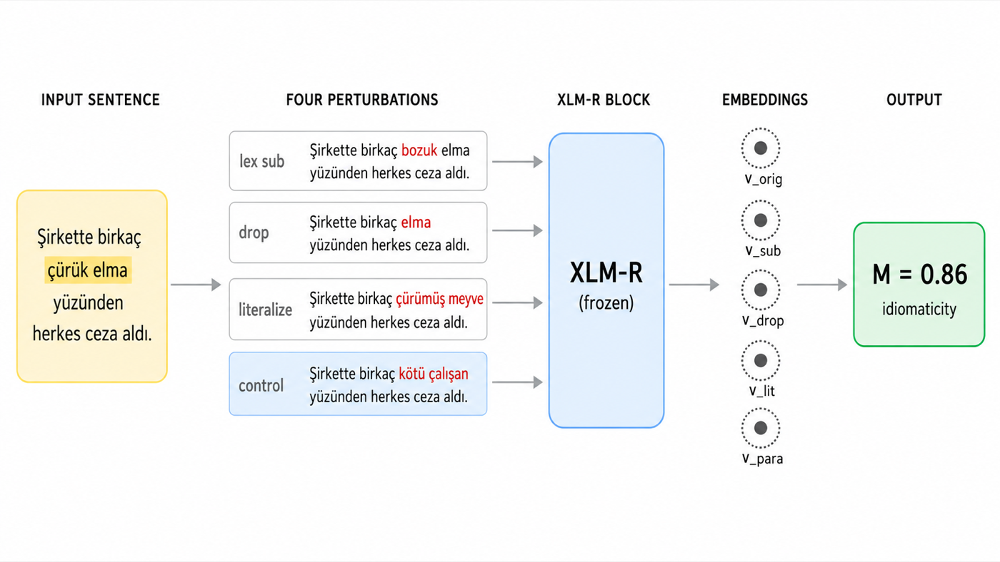
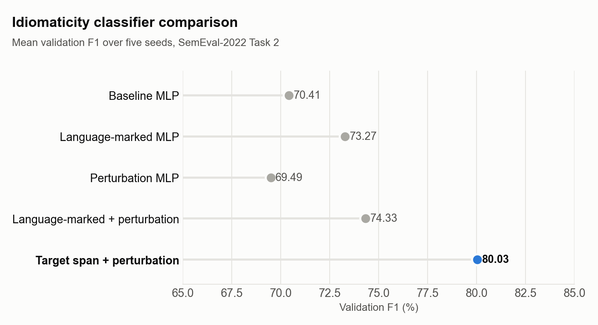
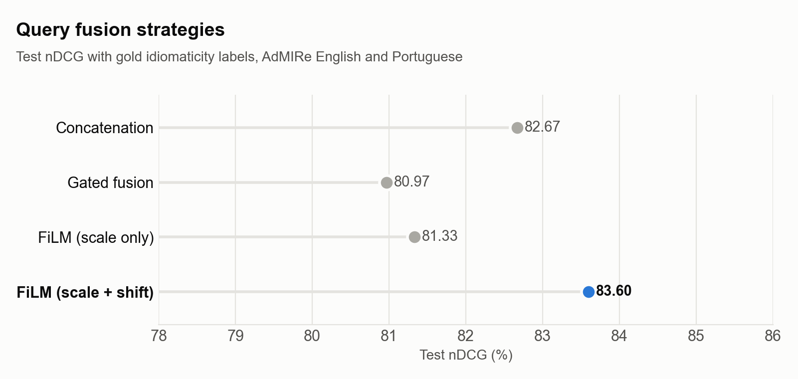
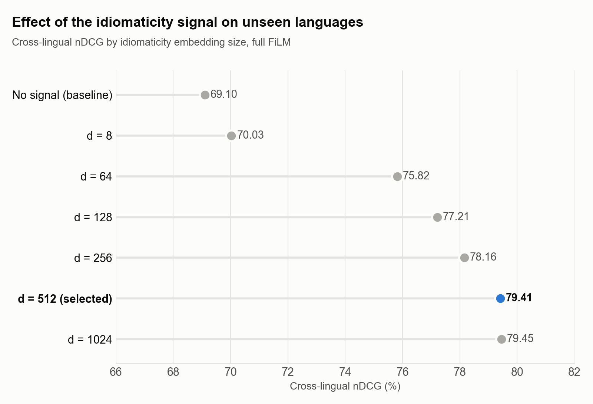

<div align="center">

# 🧩 Idiomaticity-Aware Multimodal Ranking

**Ranking images by what an expression means in context, across 15 languages.**


[](docs/report.pdf)
[](docs/proposal.pdf)

</div>

---

*"After weeks of secrecy, John finally **spilled the beans** about the surprise party."*

Shown five images, a model has to decide whether this sentence is about beans on a floor or about revealing a secret. This project tackles that problem for the **AdMIRe 2 shared task (Subtask 1, Image & Text)**: given a sentence containing a potentially idiomatic expression, rank five image–caption candidates by how well they depict its meaning in context.

The model is trained on English and Portuguese and evaluated on **15 languages**, including Turkish, Chinese, Georgian, Igbo and Kazakh, most of which it never sees during training.

## ✨ Highlights

- **Two-stage architecture:** a dedicated idiomaticity model produces a continuous signal that conditions the ranking model.
- **LLM-generated semantic perturbations:** every sentence is rewritten four ways (lexical substitution, component drop, literalization, paraphrase), and the embedding differences reveal how idiomatic the expression is.
- **FiLM-conditioned query:** the idiomaticity signal scales and shifts the query embedding before matching.
- **Multilingual and multimodal:** XLM-RoBERTa for text and CLIP for images and captions, combined with gated fusion.
- **Systematic ablations:** five idiomaticity classifiers, four fusion strategies and seven signal sizes, each evaluated over five seeds.

## 🏗️ Architecture


### Stage 1 · Idiomaticity signal

<p align="center">
  
</p>

An LLM (DeepSeek or Gemini 2.5 Flash, routed by language) rewrites each sentence in four controlled ways: lexical substitution, component drop, literalization and a meaning-preserving paraphrase. Each rewrite is verified by deterministic checks, plus an LLM-as-judge step for literalization.

The original sentence $t$ and its rewrites (paraphrase $p$, substitution $l$, component drop $c$, literalization $r$) are encoded with XLM-RoBERTa. Their absolute embedding differences form the perturbation features:

```math
x_{\text{pert}} = \big[\, |t-p| \,;\, |t-l| \,;\, |t-c| \,;\, |t-r| \,\big]
```

Five classifiers trained on SemEval-2022 Task 2 are compared. The strongest one pools the target-expression tokens and combines them with $x_{\text{pert}}$. Its sigmoid output is the idiomaticity score $M \in [0, 1]$, which stays frozen during ranking.

### Stage 2 · Multimodal ranking

| Component | Design |
| --- | --- |
| **Query** | XLM-RoBERTa sentence and target-span embeddings, concatenated and projected to 512 dimensions |
| **Idiomaticity conditioning** | Full FiLM, with scale $\gamma$ and shift $\beta$ predicted from $M$ |
| **Candidates** | Frozen CLIP ViT-B/32 image and multilingual CLIP caption embeddings, combined with a learned gate |
| **Scoring** | Cosine similarity with a learnable temperature |
| **Objective** | Listwise cross-entropy combined with top-choice cross-entropy, tuned with Optuna |

The idiomaticity signal conditions the query $Q$, and a learned gate $g_j$ balances the image $I_j$ and caption $T_j$ of each candidate:

```math
Q' = \mathrm{L2Norm}\big((1 + \gamma) \odot Q + \beta\big)
\qquad
C_j = \mathrm{L2Norm}\big(g_j \odot I_j + (1 - g_j) \odot T_j\big)
```

Candidates are ranked by $\cos(Q', C_j)$.

## 📊 Results

### Final system

Five-seed mean on the AdMIRe 2025 English and Portuguese splits and on the 13 languages unseen during training:

| Split | Top-1 accuracy | nDCG |
| --- | ---: | ---: |
| Development (EN, PT) | 43.00% | 85.65% |
| Test (EN, PT) | 40.05% | 82.46% |
| Cross-lingual (13 unseen languages) | 35.01% | 73.00% |

### What each component contributes

<p align="center">
  
</p>

Pooling over the target expression and adding perturbation features raises validation F1 from **70.4%** to **80.0%**. Perturbation features alone are weak, but they complement contextual representations.

<p align="center">
  
</p>

FiLM with both scale and shift gives the best development and test nDCG and the highest Top-1 accuracy, so it is used in the final system.

<p align="center">
  
</p>

Conditioning on idiomaticity improves cross-lingual nDCG from **69.1%** to **79.4%**. The gain is largest on languages the model has never seen.

Detailed results are in the [final report](docs/report.pdf), the [experiment notes](docs/EXPERIMENTS.md) and the notebooks in [`signal_models/`](signal_models/) and [`ranking_experiments/`](ranking_experiments/).

## 📁 Repository

| Directory | Contents |
| --- | --- |
| [`perturbation/`](perturbation/) | LLM rewrite generation and verification |
| [`signal_models/`](signal_models/) | Five idiomaticity classifiers, saved metrics and comparison notebook |
| [`signal_inference/`](signal_inference/) | Idiomaticity scores for the ranking data |
| [`src/`](src/) | Encoders, fusion modules, ranking training and submission generation |
| [`ranking_experiments/`](ranking_experiments/) | Fusion, signal-dimension and loss ablations |
| [`docs/`](docs/) | Report, proposal, setup guide and experiment notes |

## 🚀 Getting started

```bash
python -m venv .venv
source .venv/bin/activate
pip install -r requirements.txt
python -m src.ranking.train
```

Prepared LLM rewrites and idiomaticity scores are included. The AdMIRe 2 images and annotations are distributed by the task organizers. The [setup guide](docs/SETUP.md) covers the full pipeline: idiomaticity models, ranking training, ablations and submission generation.

## 🤝 Team

<div align="center">

**Deniz Topal · Furkan Yasir Göksu · Faruk Akyol**

Istanbul Technical University · YZV405E Natural Language Processing · Spring 2026

</div>
