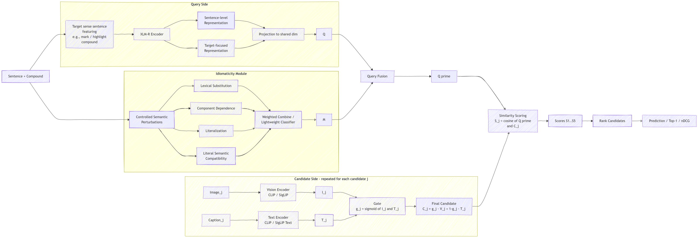

<div align="center">

# 🧩 Idiomaticity-Aware Multimodal Ranking

**Matching expressions to images by their meaning in context.**


[](docs/proposal.pdf)
[](https://github.com/Deniztpl/YZV405E_2526_Sisli)

</div>

An expression such as *spill the beans* can describe a physical action or mean revealing a secret. This project uses the surrounding sentence, candidate images, and their captions to rank the interpretation that fits the context.

Developed for the **AdMIRe 2 image-and-text ranking task** as an NLP team project at **Istanbul Technical University**, the system combines multilingual text representations, vision–language embeddings, and a learned idiomaticity signal. Each query is matched against five image–caption candidates.

## ✨ Approach

- **Multilingual text understanding:** XLM-RoBERTa represents both the sentence and the target expression.
- **Vision–language matching:** CLIP image embeddings and multilingual caption embeddings represent the candidates.
- **LLM-generated semantic perturbations:** Rewrites help estimate whether an expression is literal or idiomatic.
- **Learned fusion:** Concatenation, gating, and FiLM variants combine the idiomaticity signal with the query representation.
- **Ranking experiments:** The project compares fusion strategies, signal dimensions, and training losses, with Optuna-based tuning in the final training pipeline.

## 🏗️ Architecture



The diagram records the original design, including CLIP/SigLIP alternatives. The current implementation uses `xlm-roberta-base`, `clip-ViT-B-32`, and `clip-ViT-B-32-multilingual-v1`. Image and caption embeddings are combined through gated fusion; candidates are ranked using scaled cosine similarity.

The final training script combines a listwise objective with top-choice cross-entropy. See [experiment notes](docs/EXPERIMENTS.md) for the distinction between the final pipeline and the ablation studies.

## 📊 Recorded results

The saved final-training summary contains the following local evaluation results:

| Split | Top-1 accuracy | nDCG@5 |
| --- | ---: | ---: |
| Development | 48.96% | 0.8123 |
| Test | 34.38% | 0.7958 |
| Cross-evaluation | 14.38% | 0.7121 |

These are the recorded results for the selected run, not official shared-task leaderboard scores. Mean development nDCG across five final-training seeds was **0.7894**. The [saved summary](src/ranking/output/training_summary.json) provides the configuration and per-seed values; the experiments have not been rerun during repository cleanup.

## 📁 Repository

| Directory | Contents |
| --- | --- |
| [`src/`](src/) | Encoders, fusion modules, ranking training, and submission generation |
| [`signal_models/`](signal_models/) | Five idiomaticity classifier variants and saved experiment metrics |
| [`signal_inference/`](signal_inference/) | Generation of idiomaticity scores for ranking data |
| [`perturbation/`](perturbation/) | LLM-based rewrite and semantic-feature generation |
| [`ranking_experiments/`](ranking_experiments/) | Fusion, signal-dimension, and loss ablations |
| [`docs/`](docs/) | Setup, experiments, proposal, and architecture diagram |

## 🚀 Running the project

Start with the [setup guide](docs/SETUP.md). This repository provides training and evaluation code. Prepared rewrite records and idiomaticity scores are included; the original AdMIRe datasets and images must be supplied separately. Training produces the checkpoints used for inference.

```bash
python -m venv .venv
source .venv/bin/activate
pip install -r requirements.txt
```

The repository includes the research implementation, experiment notebooks, and recorded metrics.

## 🤝 Team

**Deniz Topal · Furkan Yasir Goksu · Faruk Akyol**

Istanbul Technical University — YZV405E

This portfolio copy is based on the team's original repository and retains its Git history. The included PDF is the project proposal; no publication or acceptance status is implied.
