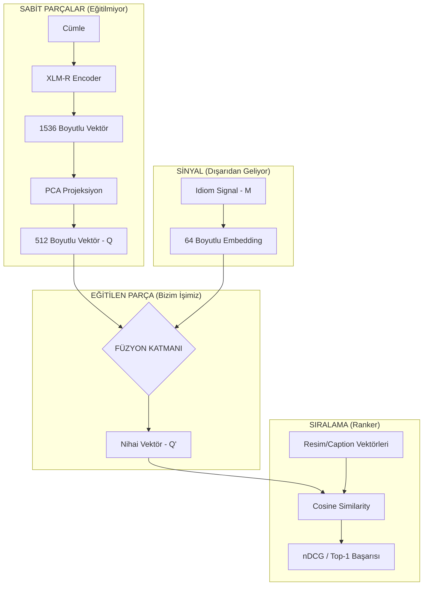

# AdMIRe 2.0 Pipeline İnşaat Planı

Bu döküman, projenin mimari yapısını ve "neyin nerede olduğunu" anlaman için hazırlanmıştır.

## 1. Genel Akış Şeması
Modelimiz bir **"Tercüman"** gibi çalışır: XLM-R dilini, CLIP (Resim) diline çevirir.

---

## 2. Biz Neyi Eğitiyoruz? (Trainable Parts)
XLM-R ve CLIP devasa modellerdir, onları eğitmeye gücümüz yetmez. Biz sadece aradaki **"Köprü"**yü eğitiyoruz.

### Durum A: Concat Modeli Seçilirse
- **Ne Yapıyor?** 512 boyutlu $Q$ ile 64 boyutlu $M$'yi yan yana koyar (576 boyut).
- **Eğitim:** Bu 576 boyutu tekrar 512'ye düşüren bir `nn.Linear` katmanı vardır. Biz bu katmanın ağırlıklarını eğitiyoruz.

### Durum B: FiLM Modeli Seçilirse
- **Ne Yapıyor?** $M$ sinyaline bakıp $Q$ vektörünü ölçekler (çarpma) ve kaydırır (toplama).
- **Eğitim:** "Hangi $M$ değeri için ne kadar çarpmalıyım?" sorusuna yanıt veren `gamma` ve `beta` ağlarını eğitiyoruz.

---

## 3. Senin Sorularının Cevapları

| Soru | Cevap |
| :--- | :--- |
| **M analizi (LLM/Ground Truth) değişecek mi?** | **HAYIR.** Elindeki $M$ sayıları (0.8, 0.2 vs.) altın değerindedir ve değişmez. |
| **Hizalanma (Alignment) nedir?** | Metin vektörünü ($Q$), doğru resmin CLIP vektörüne yaklaştırma işlemidir. |
| **Neden eğitim yapıyoruz?** | Çünkü XLM-R metni "anlar" ama CLIP resimlerini "tanımaz". Aradaki köprüyü kurmak için eğitiyoruz. |
| **Linear vs PCA nedir?** | 1536'dan 512'ye düşerken; PCA matematiksel bir formüldür (sabit), Linear ise eğitilebilir bir katmandır. |

---

## 4. Sen Şu An Neredesin ve Ne Yapacaksın?

Şu an **"Füzyon Ablation"** aşamasındasın. Yani:
1.  **Malzeme:** M=64 (Karar verildi)
2.  **Yöntem:** PCA (Karar verildi)
3.  **Soru:** "Köprüyü Concat ile mi kurayım, FiLM ile mi?"
4.  **Aksiyon:** `run.py` bittiğinde sonuçlara bakacaksın. Eğer FiLM'in nDCG puanı daha yüksekse, "Benim en iyi modelim FiLM'dir" diyeceksin ve yarışmaya onunla katılacaksın.

**Özet:** Her şey yolunda. Sadece modellerin hangisinin daha "akıllı" (yüksek nDCG) olduğunu görmeyi bekliyoruz.
